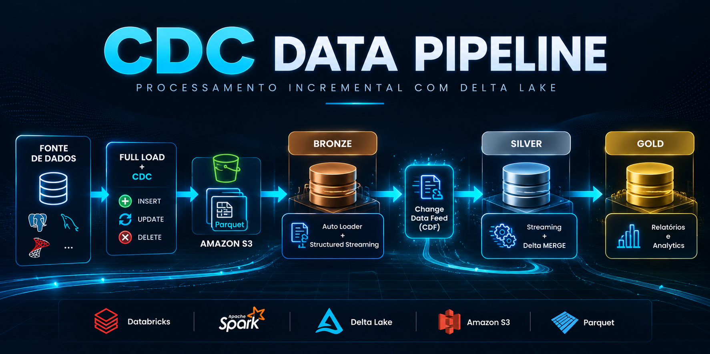

# CDC Data Pipeline

Projeto de Engenharia de Dados desenvolvido como estudo prático de processamento incremental utilizando CDC (Change Data Capture), Apache Spark, Databricks e Delta Lake.

O pipeline trabalha com cargas full-load e incrementais, propagando inserções, atualizações e exclusões entre as camadas de dados por meio de Structured Streaming, Delta Lake MERGE e Change Data Feed (CDF).

O projeto organiza o processamento em camadas Bronze, Silver e Gold, permitindo acompanhar o ciclo das alterações desde a ingestão dos dados até a construção de estruturas voltadas para consumo analítico.

## Arquitetura

O pipeline foi desenvolvido para processar alterações de dados de forma incremental, evitando a necessidade de reprocessar todo o conjunto de dados a cada execução.

O fluxo principal segue a arquitetura:

**Fonte → Full Load / CDC → Bronze → CDF → Silver → Gold**

- **Full Load:** realiza a carga inicial dos dados.
- **CDC:** captura inserções, atualizações e exclusões ocorridas após a carga inicial.
- **Bronze:** recebe e consolida os dados utilizando Auto Loader, Structured Streaming e Delta Lake.
- **CDF:** utiliza o Change Data Feed do Delta Lake para identificar e propagar alterações da camada Bronze.
- **Silver:** aplica transformações e regras de negócio sobre os dados incrementais.
- **Gold:** disponibiliza estruturas analíticas para relatórios e outros casos de uso.

## Etapas do Pipeline

O pipeline combina uma carga inicial completa com processamento incremental para identificar e propagar alterações ao longo das camadas de dados.

### Full Load e CDC

Na primeira execução, é realizada uma carga `full-load`, responsável por processar o conjunto inicial de dados.

Após a carga inicial, o pipeline passa a trabalhar de forma incremental utilizando CDC (Change Data Capture), processando inserções, atualizações e exclusões ocorridas na origem.

Os dados são disponibilizados em arquivos Parquet para processamento nas etapas seguintes do pipeline.

### Camada Bronze

Na camada Bronze, os arquivos provenientes da ingestão são processados de forma incremental utilizando `Auto Loader` e `Structured Streaming` do Apache Spark.

O pipeline utiliza checkpoints para controlar o progresso das cargas e garantir que apenas novos dados sejam processados nas execuções seguintes.

Durante cada microbatch, os registros mais recentes são identificados e consolidados em tabelas `Delta` utilizando operações de `MERGE`, permitindo tratar inserções, atualizações e exclusões.

Dessa forma, a camada Bronze mantém uma representação atualizada dos dados recebidos pelo processo de CDC.

### Camada Silver

Na camada Silver, as alterações realizadas na Bronze são consumidas utilizando `Change Data Feed (CDF)` do Delta Lake.

O CDF permite identificar as mudanças ocorridas nas tabelas Delta, incluindo inserções, atualizações e exclusões, possibilitando a propagação incremental dessas alterações.

Os dados são processados utilizando `Structured Streaming` e consolidados nas tabelas Silver por meio de operações de `MERGE`.

Nesta etapa também são aplicadas transformações e regras de negócio para disponibilizar dados tratados para as próximas etapas do pipeline.

### Camada Gold

Na camada Gold, os dados tratados na Silver são utilizados para construir estruturas voltadas ao consumo analítico.

O projeto contém consultas para diferentes necessidades de análise, incluindo relatórios diários, mensais e análises relacionadas a churn.

As cargas também permitem processamento por intervalos de datas, possibilitando operações de backfill quando necessário.

## Orquestração

O projeto possui configurações de workflows utilizadas para organizar a execução das diferentes etapas do pipeline no Databricks.

A automação utiliza a API de Jobs do Databricks para atualizar configurações dos jobs a partir dos arquivos JSON presentes no projeto.

As credenciais necessárias para comunicação com o Databricks são obtidas por meio de variáveis de ambiente, evitando armazená-las diretamente no código.

## Tecnologias utilizadas

- **Databricks** - plataforma utilizada para processamento dos dados
- **Apache Spark** - processamento distribuído
- **PySpark** - desenvolvimento das rotinas de ingestão e transformação
- **SQL** - transformações e construção das estruturas analíticas
- **Delta Lake** - armazenamento das tabelas e operações de MERGE
- **Auto Loader** - ingestão incremental dos arquivos
- **Structured Streaming** - processamento incremental
- **Change Data Capture (CDC)** - captura das alterações dos dados
- **Change Data Feed (CDF)** - propagação das alterações entre tabelas Delta
- **Amazon S3** - armazenamento dos arquivos de origem
- **Parquet** - formato utilizado na ingestão dos dados
- **Databricks Jobs API** - automação das configurações dos workflows

## Aprendizados

Este projeto permitiu praticar conceitos de Engenharia de Dados relacionados principalmente ao processamento incremental e à propagação de alterações entre diferentes camadas de dados.

Entre os principais conceitos trabalhados estão:

- Implementação de cargas full-load e incrementais
- Processamento de inserções, atualizações e exclusões utilizando CDC
- Ingestão incremental com Auto Loader e Structured Streaming
- Controle de processamento utilizando checkpoints
- Operações de upsert utilizando Delta Lake MERGE
- Propagação de alterações utilizando Change Data Feed
- Organização dos dados em camadas Bronze, Silver e Gold
- Construção de estruturas para consumo analítico
- Automação de workflows utilizando a API de Jobs do Databricks